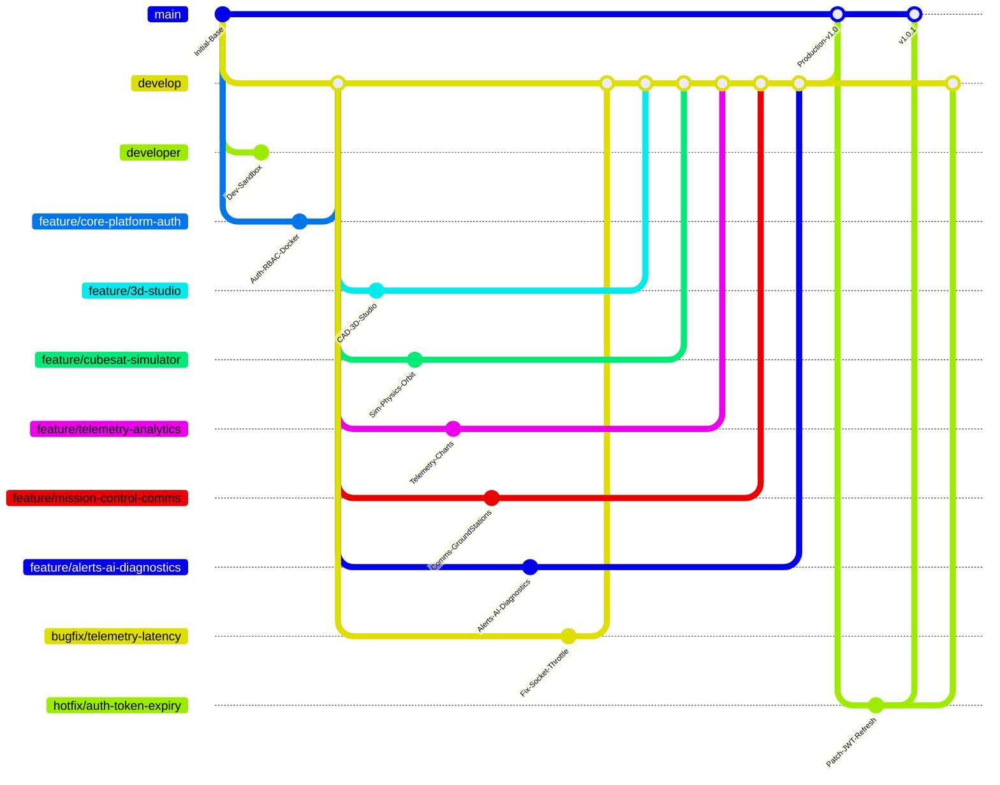

# OrbitalX Git Multi-Branch Architecture & Deployment Rules

> **MANDATORY DIRECTIVE:** All AI agents and developers **MUST** read and adhere to this document before staging, committing, branching, or pushing any code to GitHub.

---

## 1. Core Purpose & Architectural Rationale

Rather than maintaining a monolithic commit history where every module is bundled into a single branch, OrbitalX uses a **Modular Multi-Branch Architecture** with dedicated streams for:
* **Production stability** (`main`)
* **Core integration** (`develop`)
* **Developer sandbox / day-to-day work** (`developer`)
* **Isolated feature subsystems** (`feature/*`)
* **Targeted issue resolution** (`bugfix/*` and `hotfix/*`)

### Why This Architecture?
1. **Isolated Upgrades:** If a specific subsystem (e.g., 3D CubeSat Studio or AI Anomaly Engine) needs redesign or optimization, developers can clone/checkout only that specific branch (`git clone -b feature/... --single-branch`) without pulling unrelated code or risking regressions across the entire platform.
2. **Dedicated Developer Space:** Developers have a non-destructive space (`developer`) to experiment, sync intermediate work, and test before promoting to `develop`.
3. **Streamlined Bug Fixing:** Any bug in 3D physics, telemetry, or authentication can be isolated into a `bugfix/<issue>` branch, verified independently, and cleanly cherry-picked or merged without destabilizing other ongoing feature work.
4. **Merge Conflict Prevention:** Changes to one page or subsystem do not block or break concurrent development on another.

---

## 2. Standard Branch Hierarchy



| Branch Name / Pattern | Base Branch | Primary Scope | Key Modules & Files |
| :--- | :--- | :--- | :--- |
| `main` | — | Production-ready stable release | Complete integrated platform with all verified subsystems. |
| `develop` | `main` | Ongoing integration branch | Working baseline where all feature branches converge. |
| `developer` | `develop` | Daily developer workspace & sandbox | Active daily developer branch for staging, experimentation, and exploratory code before PR to `develop`. |
| `bugfix/<issue-name>` | `develop` | Targeted bug fixing during sprint | Fixes bugs identified in features before production release (e.g. `bugfix/3d-orbit-jitter`, `bugfix/telemetry-disconnect`). |
| `hotfix/<patch-name>` | `main` | Emergency production patches | Urgent security or crash patches applied directly to `main` and synced back to `develop`. |
| `feature/core-platform-auth` | `develop` | Core system, Auth & Admin | Auth (`/login`, `/register`), Admin dashboard, User management, Docker, Global layout (`DashboardLayout`), Base backend server & models. |
| `feature/3d-studio` | `develop` | 3D CAD Studio | `CubeSatStudio.jsx`, `CubeSatCanvas.jsx`, `cubesatComponents.js`, component mesh builders (`buildChassisFrame.js`, etc.). |
| `feature/cubesat-simulator` | `develop` | Orbit Simulation & Physics | `CubeSatSimulator.jsx`, `CubeSatSimulationCanvas.jsx`, `CubeSatGlobeView.jsx`, `orbitalMath.js`, Earth 3D textures, `cubesatSimService.js`. |
| `feature/telemetry-analytics` | `develop` | Telemetry Stream & Analytics | `TelemetryAnalytics.jsx`, `FleetAnalytics.jsx`, `Reports.jsx`, `telemetrySimulator.js`, `telemetryService.js`, Recharts integration. |
| `feature/mission-control-comms`| `develop` | Comms & Ground Stations | `Communications.jsx`, `GroundStations.jsx`, `MissionControl`, `cubesatCommandController.js`, `groundStationController.js`. |
| `feature/alerts-ai-diagnostics`| `develop` | Alerts, Notifs & AI Engine | `AlertsIncidents.jsx`, `NotificationCenter.jsx`, AI Diagnosis Assistant (`aiController.js`, `aiRoutes.js`, `aiService.js`, `AiDiagnosisCard.jsx`). |

---

## 3. Strict Pre-Commit & Ignore Rules

Before running `git add` or `git commit`, verify that:
1. **Never commit secrets:** `.env`, `.env.*` (except `.env.example`).
2. **Never commit build/dependency artifacts:** `node_modules/`, `dist/`, `build/`.
3. **Never commit user scratch & local folders:** 
   - `FOLDER1/`
   - `work/`
   - `details`
4. If an ignored file is accidentally tracked, execute:
   ```bash
   git rm -r --cached <file_or_folder>
   ```

---

## 4. Standard Operational Workflows

### A. Developer Day-to-Day Workflow (`developer` branch)
For daily work and experimentation without affecting integration:
```bash
# 1. Switch to developer branch
git checkout developer

# 2. Pull latest integration baseline
git pull origin develop

# 3. Work on code, test locally, and commit
git add <files>
git commit -m "chore(dev): update local test parameters"
git push origin developer
```

---

### B. Developing a New Feature (`feature/*` branch)
```bash
# 1. Start clean from develop
git checkout develop
git pull origin develop
git checkout -b feature/<feature-name>

# 2. Stage and commit atomically with semantic prefix
git add OrbitalX/frontend/src/pages/studio/
git commit -m "feat(3d-studio): implement modular CAD component placement"

# 3. Push feature branch to GitHub
git push -u origin feature/<feature-name>

# 4. Merge back to develop once verified
git checkout develop
git merge feature/<feature-name>
git push origin develop
```

---

### C. Bug Fixing Workflow (`bugfix/*` branch)
When a bug is discovered in any subsystem:
```bash
# 1. Branch off develop
git checkout develop
git pull origin develop
git checkout -b bugfix/<issue-description>

# Example: git checkout -b bugfix/sim-quaternion-drift

# 2. Apply fix and test locally
git add <affected-files>
git commit -m "fix(simulator): eliminate quaternion gimbal lock in attitude loop"

# 3. Push bugfix branch for review
git push -u origin bugfix/<issue-description>

# 4. Merge into develop
git checkout develop
git merge bugfix/<issue-description>
git push origin develop

# 5. Delete local bugfix branch once merged
git branch -d bugfix/<issue-description>
```

---

### D. Production Hotfix Workflow (`hotfix/*` branch)
When a critical bug affects production:
```bash
# 1. Branch directly off main
git checkout main
git pull origin main
git checkout -b hotfix/<patch-name>

# 2. Fix, test, and commit
git commit -m "fix(security): sanitize telemetry socket payload"

# 3. Merge into main AND develop
git checkout main
git merge hotfix/<patch-name>
git tag -a v1.0.1 -m "Patch release v1.0.1"
git push origin main --tags

git checkout develop
git merge hotfix/<patch-name>
git push origin develop
```

---

## 5. Selective Feature Upgrades in the Future

When a future team member or AI wants to update only one specific feature without touching the rest of the application:
1. Checkout only that feature branch:
   ```bash
   git checkout feature/<feature-name>
   ```
2. Make code edits, test in isolation, and commit:
   ```bash
   git add <modified-files>
   git commit -m "feat(<feature-name>): upgrade subsystem to v2"
   git push origin feature/<feature-name>
   ```
3. Test and pull request into `develop`.
