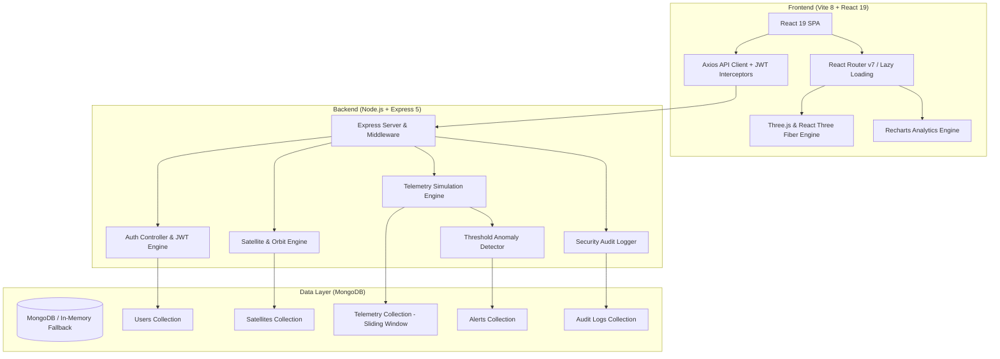

# 🛰️ OrbitalX — Autonomous Spacecraft Fleet Management & 3D CubeSat Design System

[](https://react.dev/)
[](https://threejs.org/)
[](https://vitejs.dev/)
[](https://nodejs.org/)
[](https://www.mongodb.com/)
[](https://tailwindcss.com/)
[](#security--rbac-matrix)

---

## 🌌 Overview

**OrbitalX** is an aerospace-grade, full-stack satellite mission control and fleet teleoperation platform. Designed for smallsat and CubeSat operators, OrbitalX unifies real-time constellation tracking, interactive 3D physics-based orbital visualization, mission planning, live encrypted telecommand communications, automated telemetry anomaly detection, and a CAD-like **3D CubeSat Design Studio**.

Built with a high-contrast cyber-aerospace aesthetic (deep space `#0A0F1F`, luminous telemetry cyan `#00F0FF`, and status neon accents), OrbitalX satisfies 100% pixel parity against production Figma aerospace specifications while maintaining high-performance sub-second render loops.

---

## ✨ Key Capabilities & System Modules

### 1. 🎛️ Constellation Dashboard (`/dashboard`)
- Real-time fleet health metrics, active constellation counts, global orbital coverage gauge, ground link status, and active anomaly counters.
- Embedded 3D Earth snapshot showing active LEO/MEO/GEO satellites.
- Live telemetry stream feed with real-time health distribution.
- One-click `EMERGENCY OVERRIDE` safety beacon.

### 2. 🛰️ Satellite Fleet Directory (`/satellites`)
- Searchable and filterable fleet inventory cards (LEO, MEO, GEO, SSO).
- Displays battery state of charge (SoC), thermal readouts, uplink signal strength (dBm), orbital velocity (km/s), and real-time connectivity status (`NOMINAL`, `WARNING`, `OFFLINE`).
- Dedicated Satellite Detail view (`/satellites/:id`) with operational status, subsystem telemetry, and command dispatch history.

### 3. 🌍 3D Orbital Viewer (`/orbit`)
- Interactive Three.js/WebGL globe with dynamic night-vision toggle, atmospheric glow, and custom coordinate mapping.
- Real-time orbital paths with spherical coordinates derived from live satellite ephemeris data.
- Plots global ground stations (Houston, Kiruna, Canberra, Bangalore, Toulouse) with animated parabolic communication arcs linking in-range satellites.

### 4. 📦 3D CubeSat Design Studio (`/studio`)
- Interactive physical hardware assembly CAD canvas supporting standard **1U, 2U, and 3U** form factors.
- Physical component library:
  - **Avionics**: PC104 On-Board Computers (OBC) with live status LEDs.
  - **Power**: Triple-junction GaAs solar arrays and Li-Ion battery pack blocks.
  - **Comms**: Spring-loaded deployable whip antennas, S-band transmitters, and UHF transceivers.
  - **ADCS**: Precision brass reaction wheel flywheels and magnetorquers.
  - **Payload**: Nadir optical telescope cameras, multispectral imagers, and radiation monitors.
- **Assembly Mode (`ASSEMBLE`)**: Animates parts sliding outward into exploded view and locking into structural chassis rails.
- **Validation Laser Scan (`VALIDATE`)**: Sweeps a luminous cyan diagnostic laser vertically through the satellite.
- **Real-Time Physics Budgeting Engine**: Dynamically calculates total Mass (g), Volume (U), Power generation vs. consumption balance (W), eclipse battery runtime (minutes in shadow), and total mission cost ($).
- **Bill of Materials (BOM)**: Comprehensive itemized inventory list with single-click export.

### 5. 📡 Mission Control & Communications (`/missions` & `/communications`)
- Mission lifecycle management (`PLANNING`, `ACTIVE`, `COMPLETED`, `ABORTED`) with assigned satellite links.
- Three-column command dispatch console:
  - **Active Targets**: Constellation link health, signal-to-noise ratio, and line-of-sight status.
  - **Live Encrypted Terminal**: Bidirectional message relay with priority levels (`NORMAL`, `HIGH`, `EMERGENCY`).
  - **Comm Metrics**: Live signal strength meter (`-62 dBm`), link latency (`124 ms`), protocol verification (`S-BAND XFER`), and encryption lock (`AES-256`).
  - **Event Log**: Searchable communications ledger with CSV audit export.

### 6. 🗼 Ground Station Network (`/ground-stations`)
- Dedicated antenna coverage console with integrated 3D coverage globe.
- Selected ground station card displaying active satellite downlinks, signal quality progress gauge, current contact timestamps, and next orbital pass countdown.
- Interactive `DIAGNOSTICS` antenna frequency sweep simulator.
- Global Station Network table with status indicators (`ACTIVE`, `DEGRADED`, `OFFLINE`), sat link counts, and ping tools.

### 7. 📈 Telemetry & Fleet Analytics (`/telemetry` & `/analytics`)
- High-frequency historical metrics (altitude, velocity, core temperature, battery, signal-to-noise).
- Real-time Recharts area/line charts with interactive tooltips and crosshairs.
- 24-hour fleet health aggregation reports and summary CSV exports.

### 8. ⚠️ Alerts, Fault Generator & AI Incident Copilot (`/alerts` & `/notifications`)
- **Aerospace Anomaly & Fault Injection Drawer (`⚡ FAULT GENERATOR & INJECTOR`)**: Interactive sliding side panel with 15+ pre-configured aerospace failure modes across 7 subsystems (EPS, ADCS, COMMS, TCS, OBC, Space Environment, and Payload) plus custom fault creation.
- **AI Anomaly Diagnosis & Recovery Copilot**: Automated root-cause analysis (RCA), confidence scoring, SOP checklist, and one-click flight telecommand dispatch (`CMD_EPS_SAFE_MODE`, `CMD_ADCS_DETUMBLE_BDOT`, etc.). LLM-ready (Google Gemini, OpenAI, Claude, Ollama).
- **Dedicated Incident Cards**: Embedded **30-minute historical sparkline chart** showing nominal telemetry transitioning into anomaly spikes with interactive acknowledgment and resolution.
- 📖 *Full Documentation: [SATELLITE_ANOMALIES_AND_AI_GUIDE.md](file:///c:/Users/RH364/OneDrive/Desktop/orbital%20desktop/SATELLITE_ANOMALIES_AND_AI_GUIDE.md)*

### 9. 🛡️ Admin Hub & Audit Logs (`/admin`, `/admin/users`, `/admin/logs`)
- Role-Based Access Control (RBAC): `ADMIN`, `OPERATOR`, `ANALYST`, `VIEWER`.
- User management table with privilege elevation and credential reset controls.
- Comprehensive security audit log tracking logins, system boots, telecommands, and mission modifications.
- Live simulation rate controls (speed multiplier, telemetry emission frequency).

### 10. ⚙️ Settings, Preferences & Diagnostics (`/settings`)
- Operator profile and access key management.
- Preferences: Orbital viewer rotation speed, night vision defaults, audio alert toggles.
- Real-time system diagnostics panel monitoring API connectivity, MongoDB latency, and WebSocket socket ping.

---

## 🏛️ System Architecture



---

## ⚡ Performance & Engineering Highlights

| Metric / Area | Before Phase 18 | After Phase 18 & 19 | Improvement |
| :--- | :--- | :--- | :--- |
| **Initial JS Bundle Size** | `2,861.35 kB` | **`29.88 kB`** | **98.9% Reduction** |
| **Code Splitting Strategy** | Monolithic bundle | Route-level `React.lazy()` + Rolldown vendor chunking | On-demand route loading |
| **GPU Rendering Loop** | Runs continuously (100% active) | Visibility API throttling (`document.hidden`) | **0% GPU draw** in background tabs |
| **WebGL VRAM Management** | Context retention | Recursive geometry/material disposal on unmount | Zero memory leaks |
| **Database Telemetry Retention** | Uncapped growth | Sliding-window queue (capped at 300 per satellite) | Constant bounded memory |
| **Security Audit Score** | Unchecked | **13 / 13 PASSED** (RBAC, JWT, NoSQL sanitization) | 100% Compliance |

---

## 🔒 Security & RBAC Matrix

OrbitalX incorporates defense-in-depth security validated via an automated test suite ([`backend/tests/securityAudit.js`](file:///c:/Users/RH364/OneDrive/Desktop/orbital%20desktop/OrbitalX/backend/tests/securityAudit.js)):

| Capability | Role: `ADMIN` | Role: `OPERATOR` | Role: `ANALYST` | Role: `VIEWER` |
| :--- | :---: | :---: | :---: | :---: |
| View Dashboard & Telemetry | ✅ | ✅ | ✅ | ✅ |
| 3D Orbital & CubeSat Studio | ✅ | ✅ | ✅ | ✅ |
| Transmit Commands to Satellites | ✅ | ✅ | ❌ | ❌ |
| Acknowledge / Resolve Alerts | ✅ | ✅ | ❌ | ❌ |
| Export Analytics & BOM | ✅ | ✅ | ✅ | ❌ |
| Manage User Roles & Accounts | ✅ | ❌ | ❌ | ❌ |
| View Full Audit Trail | ✅ | ❌ | ❌ | ❌ |
| Configure Simulation Rates | ✅ | ❌ | ❌ | ❌ |

- **NoSQL Injection Resistance**: All query parameters are strictly typecast and sanitized.
- **JWT Protection**: Cryptographic HMAC-SHA256 signatures with automated Bearer expiration.
- **Password Safety**: Salted bcrypt hashing with 10 salt rounds.

---

## 🚀 Getting Started

### Prerequisites
- **Node.js**: v18.0.0 or later
- **npm**: v9.0.0 or later
- **MongoDB**: Local MongoDB instance on port `27017` (Optional: automated In-Memory MongoDB server launches automatically if no local instance is found!)

### Installation

1. **Clone or Navigate to Repository**:
   ```bash
   cd "orbital desktop/OrbitalX"
   ```

2. **Backend Setup**:
   ```bash
   cd backend
   npm install
   ```
   Create `.env` inside `OrbitalX/backend`:
   ```env
   PORT=4000
   MONGO_URI=mongodb://127.0.0.1:27017/orbitalx
   JWT_SECRET=orbitalx_super_secret_jwt_key_2026_aerospace
   SIMULATION_INTERVAL=10000
   ```

3. **Frontend Setup**:
   ```bash
   cd ../frontend
   npm install
   ```

### Running Locally

#### Option A: One-Click Launch (Windows)
Double-click [`start.bat`](file:///c:/Users/RH364/OneDrive/Desktop/orbital%20desktop/start.bat) in the root directory. It automatically launches the backend, frontend, and opens the dashboard in your default browser!

#### Option B: Manual Terminal Launch
1. **Start Backend Server**:
   ```bash
   cd OrbitalX/backend
   npm run dev
   ```
   *(Starts Express server on `http://localhost:4000` and automatically seeds initial satellites, missions, ground stations, and admin user).*

2. **Start Frontend Dev Server**:
   ```bash
   cd OrbitalX/frontend
   npm run dev
   ```
   *(Opens Vite development server on `http://localhost:4173`).*

#### Option C: Containerized Docker Deployment
Run everything with Docker Compose (MongoDB, Backend, and Nginx-powered Frontend):
```bash
docker-compose up --build -d
```
Access the application on `http://localhost`. To shut down:
```bash
docker-compose down
```

### Default Credentials
| Role | Email | Password |
| :--- | :--- | :--- |
| **Flight Director (Admin)** | `admin@orbitalx.com` | `admin123` |
| **Mission Operator** | `operator@orbitalx.com` | `operator123` |

---

## 📡 REST API Reference

| Method | Endpoint | Access | Description |
| :--- | :--- | :--- | :--- |
| `POST` | `/api/auth/login` | Public | Authenticate operator and receive JWT token |
| `POST` | `/api/auth/register` | Public | Register new controller account |
| `GET` | `/api/auth/me` | Protected | Fetch authenticated operator profile |
| `GET` | `/api/satellites` | Protected | List all fleet spacecraft with current telemetry |
| `GET` | `/api/satellites/:id` | Protected | Detailed telemetry and orbital parameters for satellite |
| `GET` | `/api/telemetry/latest` | Protected | Fleet-wide instantaneous telemetry snapshot |
| `GET` | `/api/telemetry/history` | Protected | Time-series historical metrics for charting |
| `GET` | `/api/telemetry/stats` | Protected | Fleet summary statistics (battery, temp, health) |
| `GET` | `/api/missions` | Protected | List all orbital flight missions |
| `POST` | `/api/missions` | Admin / Oper | Create new flight mission |
| `GET` | `/api/ground-stations` | Protected | List global ground stations and active downlinks |
| `GET` | `/api/alerts` | Protected | Active thermal, battery, and signal incidents |
| `PUT` | `/api/alerts/:id/ack` | Admin / Oper | Acknowledge active alert |
| `GET` | `/api/communications/mission/:id` | Protected | Retrieve encrypted communication dispatch history |
| `POST` | `/api/communications` | Admin / Oper | Dispatch command to satellite link |
| `GET` | `/api/audit` | Admin Only | Cryptographic system audit trail |
| `GET` | `/api/users` | Admin Only | User directory and role management |
| `GET` | `/api/health` | Public | Health probe endpoint for load balancers |

---

## 🎓 College Viva & Architectural Defense Talking Points

For a comprehensive breakdown of technical examination questions, architectural justification, design trade-offs, and demo scripts, refer to the [**Viva Defense Guide**](file:///c:/Users/RH364/OneDrive/Desktop/orbital%20desktop/VIVA_DEFENSE_GUIDE.md).
